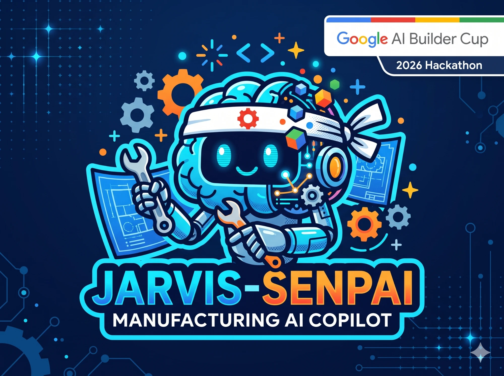

**"Jarvis for the factory floor."**
An agentic AI copilot for small manufacturers — scan a raw-material tag and Senpai tracks it, predicts what's about to expire or run low, drafts the reorder, and answers the floor by voice in any language.

**Google Cloud AI Builder Cup 2026 · Manufacturing: Intelligent Operations · Team Artemis**

🔗 **[Open the live app →](https://jarvis-senpai.ai.studio)**

---

## 📸 A look inside

&nbsp;&nbsp;

---

## 🏭 The problem
Small manufacturers lose real money to materials that quietly expire, run out, or get reordered by hand — and they can't afford enterprise inventory software. Jarvis Senpai gives them an agentic copilot that runs on a phone.

## ✨ What it does
- **📷 Scan → Inventory.** Point your phone at a material label. Gemini reads it in any language, computes the expiry date, and logs it to Firestore. If it isn't a real label, it says so — **it refuses to hallucinate** (returns "No label detected", confidence 0) instead of inventing data.
- **📉 Predict & Reorder.** Flags items expiring soon or below their safety threshold, explains why in plain language, and drafts a purchase order — **a human always approves; nothing is placed automatically.** It never invents a stock threshold without your input.
- **🛒 Supplier Suggestions.** Surfaces supplier options for each material inside the reorder flow (clearly labelled when sample data).
- **🎙️ Senpai Copilot.** A voice-first assistant with a live gradient orb — ask about the floor by voice or text in **English, Hindi, or Kannada**, and it calls the right tool and answers aloud. A proactive "Bankai — Today" card greets you with what needs attention.
- **🧾 Batch History & Traceability.** Full provenance and usage log for every batch / LOT.

## ☁️ Built on Google Cloud
- **Gemini** — multimodal label reading + the copilot's reasoning and tool-calling
- **Firebase** — Firestore (live data), Hosting, and Cloud Run deployment
- **Browser SpeechRecognition + SpeechSynthesis** — multilingual voice in and out

## 🧱 Architecture
Four independent pipelines over one shared Firestore schema and a common agent tool contract — `scanItem`, `predictAlerts`, `findSuppliers`, `draftOrder` — unified by the Senpai voice copilot:

`1. Scan & Inventory` · `2. Predict & Reorder` · `3. Supplier Search` · `4. Senpai Copilot + Bankai digest`

## 🛠️ Run locally
Prerequisites: Node.js
1. `npm install --legacy-peer-deps`
2. Set `GEMINI_API_KEY` in `.env.local`
3. `npm run dev`

## 👥 Team Artemis
Ranjitha Nayak (lead) · Amogh · Rohan · Aishwarya

---

Built for the Google Cloud AI Builder Cup 2026.

